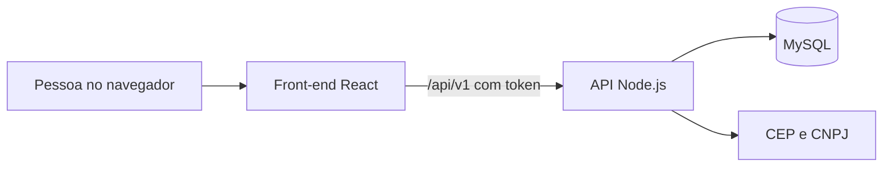

# Mantiqueira Distribuidora: front-end

Site de pedidos B2B da **Mantiqueira Distribuidora**, feito como Projeto Integrador da Unifeob (equipe 5). É a parte que as pessoas veem no navegador: a **loja** para os lojistas e a **área do gestor** para a equipe da empresa. Ele conversa com a API [BackMantiqueiraWeb](https://github.com/Soares23Ana/BackMantiqueiraWeb) em `/api/v1`.


## Sumário

1. [Funcionalidades](#funcionalidades)
2. [Tecnologias](#tecnologias)
3. [Como rodar](#como-rodar)
4. [Acessos de teste](#acessos-de-teste)
5. [Rotas](#rotas)
6. [Como o front conversa com a API](#como-o-front-conversa-com-a-api)
7. [Estrutura do projeto](#estrutura-do-projeto)
8. [Decisões do projeto](#decisões-do-projeto)
9. [Limitações conhecidas](#limitações-conhecidas)
10. [Documentação relacionada](#documentação-relacionada)

## Funcionalidades

### Loja do cliente

- **Home dirigida pelo painel de conteúdo:** banners, campanhas ativas com selo, destaques, aviso do topo e botão de WhatsApp.
- **Catálogo:** busca sem acento com sugestões enquanto digita, filtros por categoria, marca e disponibilidade, ordenação e paginação. O estado fica no endereço da página, então o botão voltar do navegador funciona e o link pode ser compartilhado.
- **Produto:** foto com zoom, descrição, destaques e quantidade que respeita a embalagem de venda (múltiplo de venda).
- **Carrinho e favoritos:** ficam guardados no navegador, com avisos de estoque e de produto indisponível.
- **Cadastro e entrada:** login único por CNPJ ou e-mail. No cadastro, mostra o nome da empresa na Receita ao completar o CNPJ e preenche o endereço ao completar o CEP.
- **Checkout:** escolha de endereço, data desejada e observação. Se algum item tiver problema, mostra todos de uma vez, com botão para ajustar.
- **Minha conta:** pedidos com linha do tempo e histórico, "Repetir pedido", cancelamento com motivo, perfil, endereços e troca de senha.

### Área do gestor (`/gestor`)

| Tela | O que a equipe faz |
| --- | --- |
| Painel | Vê pedidos pendentes, estoque baixo, clientes ativos, novos cadastros e alertas de reposição |
| Pedidos | Busca e filtra, avança o andamento com observação, cancela com motivo obrigatório e exporta planilha |
| Produtos | Cadastra e edita com foto, ajusta o estoque com observação, vê o histórico e gerencia categorias e marcas |
| Importação | Envia planilha CSV com modo simulação, relatório de erros por linha e histórico das sincronizações |
| Clientes | Busca, filtra os novos de 7 dias, bloqueia acesso, corrige dados e define senha temporária |
| Conteúdo (CMS) | Edita banners, blocos de texto, contatos, aviso do topo e meta de reposição |
| Campanhas | Cria selo, período e produtos, e encerra campanhas |
| Métricas | Vê buscas, funil de compra, produtos mais vistos e pedidos, cliques e pedidos por dia, e clientes sem comprar |
| Equipe | Cria e desativa usuários da equipe (só para quem tem a marca de gerenciar a equipe) |
| Saúde do sistema | Vê o banco, as tarefas automáticas e as últimas sincronizações |

## Tecnologias

- **React 18** e **TypeScript** (modo estrito)
- **Vite 6** para o desenvolvimento e o build
- **Tailwind CSS 4** para o visual
- **React Router 6** para as rotas
- **Node.js 20 ou superior** para rodar as ferramentas

## Como rodar

O front precisa da API ligada. Siga as duas partes na ordem.

### 1. Ligar a API

Na pasta do back ([BackMantiqueiraWeb](https://github.com/Soares23Ana/BackMantiqueiraWeb)), crie o arquivo `.env` a partir de `.env.example` (com a senha do seu MySQL e um `JWT_SECRET` de pelo menos 32 caracteres) e rode:

```bash
npm install
npm run migrar          # cria o banco e aplica as migrations
npm run seed:catalogo   # 38 produtos
npm run seed:dev        # usuários de teste
npm run seed:demo       # banners, campanha, contatos e 5 pedidos de exemplo
npm run dev             # API em http://localhost:3000
```

Confira em `http://localhost:3000/saude`: deve mostrar `{"status":"ok","banco":"conectado"}`.

### 2. Ligar o front

Em outro terminal, na pasta do front:

```bash
npm install
npm run dev             # site em http://localhost:5173
```

### Scripts

| Comando | O que faz |
| --- | --- |
| `npm run dev` | Liga o site em modo de desenvolvimento |
| `npm run build` | Verifica os tipos (TypeScript) e gera a versão de produção na pasta `dist` |
| `npm run preview` | Mostra a versão de produção no computador |

### Variáveis de ambiente

| Variável | Quando usar | Exemplo |
| --- | --- | --- |
| `VITE_API_PROXY` | Só em desenvolvimento, se a API não estiver na porta 3000 | `http://localhost:3001` |
| `VITE_API_URL` | Em produção, com o endereço público da API | `https://api.exemplo.com.br` |

Em desenvolvimento, o Vite encaminha `/api`, `/arquivos` e `/saude` para `http://localhost:3000`, então o site usa caminhos relativos e não depende de CORS. Para trocar a porta no PowerShell:

```powershell
$env:VITE_API_PROXY="http://localhost:3001"; npm run dev
```

Em produção, rode `npm run build` com `VITE_API_URL` definido e libere o endereço do site em `CORS_ORIGINS` na API. Veja `.env.example`.

## Acessos de teste

Criados por `npm run seed:dev` na API. A senha de todos é `Mantiqueira@2026`.

| Perfil | Login |
| --- | --- |
| Cliente | CNPJ `11.222.333/0001-81` |
| Equipe (gerencia a equipe) | `admin@mantiqueira.com` |
| Equipe | `gerente@mantiqueira.com` e `funcionario@mantiqueira.com` |

A tela de entrada é única e neutra: não menciona a equipe. O mesmo campo aceita CNPJ (numérico ou com letras) ou e-mail, e a regra é só o `@`. Com `@` é e-mail e a pessoa vai para `/gestor`. Sem `@` é CNPJ e a pessoa vai para "Minha conta".

## Rotas

| Rota | Tela | Quem acessa |
| --- | --- | --- |
| `/` | Página inicial | Todos |
| `/produtos` e `/categoria/:slug` | Catálogo com busca, filtros e páginas | Todos |
| `/marca/:slug` e `/produto/:id` | Marca e produto | Todos |
| `/favoritos` e `/carrinho` | Favoritos e carrinho | Todos |
| `/entrar` e `/cadastro` | Entrada e criação de conta | Todos |
| `/checkout` | Finalizar o pedido | Cliente |
| `/minha-conta/pedidos`, `/perfil`, `/enderecos` e `/senha` | Área do cliente | Cliente |
| `/gestor` e `/gestor/...` | Área da equipe | Equipe |
| `/gestor/equipe` | Gestão da equipe | Equipe com a marca de gerenciar a equipe |

As rotas protegidas redirecionam: sem login, vão para `/entrar` e voltam depois. Um cliente que abre `/gestor` volta para a página inicial.

## Como o front conversa com a API



- **Um cliente único** (`src/api/client.ts`) envia o token, lê a resposta em JSON e transforma os erros em um objeto com mensagem, código e campos com problema.
- **Validação em dois lugares:** a tela confere o que dá para saber sem perguntar (campo vazio, CNPJ com dígito errado, senhas diferentes), e a API confere as regras do negócio. Os erros por campo aparecem embaixo do campo certo.
- **Cada resposta tem um comportamento:** 401 leva ao login com "Sua sessão expirou", 409 com itens indisponíveis mostra a lista para ajustar, 422 marca os campos, 429 pede para esperar e 503 deixa a pessoa seguir à mão.
- **Três estados em toda tela que busca dados:** carregando, erro com botão "Tentar de novo" e lista vazia com uma frase clara.
- **A tela se atualiza sozinha** depois de cada operação: contador do carrinho, histórico do pedido, selos do menu do gestor e listas recarregadas.

## Estrutura do projeto

```text
src/
├── api/client.ts          chamadas à API, token, erros e endereços de imagem
├── context/               sessão (Auth), carrinho e favoritos (Cart), dados públicos (Store) e avisos (Toast)
├── hooks/useApi.ts        carregando, erro e recarregar de cada chamada
├── pages/                 telas da loja
│   ├── account/           Minha conta
│   └── manager/           telas do gestor
├── components/            peças reutilizáveis (cabeçalho, cartão de produto, campos de formulário)
│   └── manager/           peças do gestor (menu lateral, tabelas, janelas, paginação)
├── data/brands.ts         texto editorial das páginas de marca (o id é o slug da marca na API)
├── utils/                 CNPJ, datas, telefone, CEP, planilhas e avisos de métricas
└── types.ts               tipos no formato da API
public/img/                fotos dos produtos de exemplo e logotipo
```

## Decisões do projeto

- **Nada financeiro nas telas de dados:** sem preço, total, faturamento ou tabela de preço. A API também não envia valores, porque a equipe do projeto não tem acesso ao financeiro.
- **Visitante** vê só a disponibilidade do produto. **Cliente logado** vê o estoque exato.
- **Status do pedido** iguais aos do back: Aguardando Separação, Em Separação, Saiu para Entrega e Entregue (ou Cancelado, com motivo obrigatório).
- **Nome de exibição:** clientes e pedidos aparecem pela razão social, ou pelo nome do responsável quando não há razão social (`nome_exibicao`).
- **CNPJ com letras:** a Receita Federal emite esse formato desde julho de 2026. A máscara, a validação (módulo 11, com cada caractere valendo o código ASCII menos 48) e o login aceitam letras nas 12 primeiras posições (`src/utils/cnpj.ts`).
- **Consultas de CEP e CNPJ no cadastro** (`GET /cep/:cep` e `GET /cnpj/:cnpj`) são só apoio: se falharem, a pessoa digita à mão e o cadastro continua.
- **Pedido sem duplicar:** o checkout envia uma `Idempotency-Key` (uma por abertura da tela). Um reenvio devolve o mesmo pedido.
- **Troca de senha encerra a sessão:** a API invalida os tokens anteriores, e o front leva de volta ao login com um aviso.
- **Sessão de 8 horas.** Qualquer resposta 401 leva ao login com o aviso de sessão expirada.
- **Novos cadastros no gestor** (selo no menu, card no painel e filtro "Novos (7 dias)") servem só para consulta: não há aprovação de cadastro.

## Limitações conhecidas

- O **texto das páginas de marca** (`src/data/brands.ts`) e os **textos de divulgação da página inicial** (como "frete grátis" e "pedido mínimo") ficam no código. Os de divulgação foram herdados do site original e precisam ser confirmados com a empresa.
- O **carrinho e os favoritos** ficam no navegador de cada pessoa, não acompanham outro computador.
- O front **não tem testes automáticos**. Foi conferido à mão contra a API, e o `npm run build` termina sem erros. Ainda falta testar no celular, em outros navegadores e o envio de planilha e de fotos pela tela.
- Não há envio de e-mails nem recuperação de senha sozinha: quem esquece a senha chama a empresa pelo WhatsApp, e a equipe define uma senha temporária.
- As **fotos enviadas** pela equipe ficam no servidor da API. A ideia futura é guardá-las na nuvem.

## Documentação relacionada

- **Guia do front-end** e **guia do back-end** (PDF do projeto): passo a passo, regras, testes e glossário em linguagem simples.
- No repositório do back: `docs/API.md` (todos os endereços da API) e `docs/MAPA_FRONT_API.md` (cada tela e o endereço da API que ela usa).

## Equipe

Amanda, Ana Júlia e equipe 5, Unifeob. Projeto Integrador, 2026.
